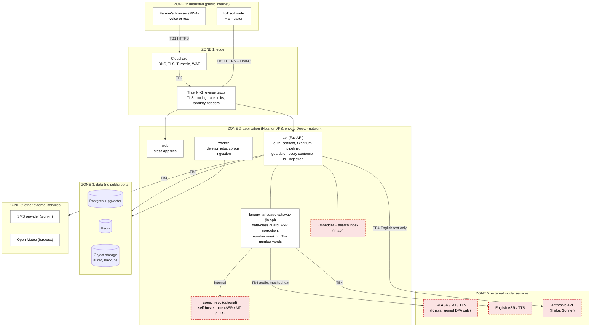

# Architecture

## 1. Containers, trust boundaries and learned components

Sonovarem runs as a modular FastAPI monolith on one Hetzner VPS. Traefik is the reverse proxy and Cloudflare sits in front. Nodes with a **red dashed outline are learned components**: their behaviour is inferred from data. Everything else is code we specify and test.

**Trust boundaries:**

| Boundary | Between | Main control |
|---|---|---|
| TB1 | Browser and Cloudflare | HTTPS; Turnstile; WAF basics |
| TB2 | Cloudflare and our server | Origin accepts Cloudflare only (Hetzner Cloud Firewall); request size limits |
| TB3 | Application and data stores | No public ports; least-privilege roles; pre-signed URLs for audio |
| TB4 | Our server and external services | Egress allow-list; paid tiers only; a data-class guard on every provider call |
| TB5 | Soil sensor and our server | HTTPS; an HMAC signature over the body, a timestamp and a nonce; timestamps outside ±300 s rejected; nonces de-duplicated, so a captured payload cannot be replayed *(amended 2026-10-02)*; plausibility and freshness checks |

## 2. The learned-component boundary

There are five learned components:
- speech recognition (ASR);
- translation (MT);
- the language model (LLM);
- the retrieval embedder;
- speech synthesis (TTS).

Every call to them passes through a port we own:
- the **language gateway** (`langgw`) for speech and translation;
- the LLM port;
- the retrieval module.

So the form of each crossing is under our control, even where the model is not, and a Twi engine can be swapped by configuration. Only English text reaches the language model, and its output is untrusted until the guards have checked each sentence.

| Crossing | Direction | Form | Under whose control |
|---|---|---|---|
| Speech | in | Opus audio, 16 kHz, ≤ 60 s; the turn's data class (team, rater, farmer) | Model: Khaya (only under a signed data agreement) or our self-hosted model. Routing rule: us |
| Transcript | out | Text, confidence, number spans, language-mismatch score, model version | Untrusted until corrected and confirmed at echo-back |
| Translation | in / out | Numbers, units and product names replaced by placeholders, checked on return. Sentences carrying a dose, product or warning are also back-translated at runtime and compared with the English source *(amended 2026-10-02)* | Provider or us. A lost placeholder triggers a retry, then English text. A meaning change in a safety sentence falls back to the pre-recorded template and English text |
| Prompt | in | English only: question, retrieved passages quoted as data, timestamped tool readings; no audio, names or phone numbers | Anthropic (paid tier, no training on inputs); prompts versioned by us |
| Answer | out | Structured sentences with citation IDs, one at a time | Untrusted until each sentence passes G-DOSE, G-REG and G-NUM |
| Speech out | in / out | Twi text with numbers already written as words; an audio clip | Provider or us |

## 3. Interfaces, failure modes and operational dependencies

**Interfaces.** The boundary implies four typed interfaces, each with a deadline and a data class:

| Interface | Owned by |
|---|---|
| `understand(audio or text)` | Language gateway |
| `render(sentences)` | Language gateway |
| `answer(prompt)` (streaming) | LLM port |
| `search(query)` | Retrieval |

Each adapter returns its model version, so a silent upstream change is visible.

**Operational dependencies:**
- the Twi speech provider and its data agreement;
- Anthropic's API and terms;
- a GPU, if an open speech model wins our week-2 comparison;
- the licence of each source document;
- the currency of the EPA pesticide register;
- an approved SMS sender ID for sign-in.

| What fails | How it shows to the user | How we detect it | What the system does meanwhile |
|---|---|---|---|
| ASR mishears (fluent but wrong) | The echo-back says the wrong question | Echo-back rejections; falling ASR confidence | Asks again, then offers a menu of common questions |
| ASR misses a domain term | A product or pest name is wrong | Corrections applied or suggested in `langgw` | Known variants corrected; near matches confirmed by the farmer |
| Translation drops or changes a number | A dose or date would be wrong | Placeholder check on every translation call | Retry, other engine, then English text and "ask your helper" |
| Translation changes the meaning of a safety sentence (for example, drops a negation) *(added 2026-10-02)* | Advice that says the opposite of the source | Runtime back-translation check on dose, product and warning sentences | The pre-recorded Twi template is spoken and the English text is shown |
| LLM states an unsupported dose or product | Would be unsafe advice | Guard verdicts | The sentence is replaced; the product is withheld |
| Retrieval finds nothing relevant | A vague or wrong answer | Retrieval scores; "I don't know" rate | "I don't know" with who can help |
| Provider outage, slowdown or silent model change | Long wait, or quality drops with no error | Errors, latency and model version per provider (TB4) | Circuit breaker, secondary provider, English voice or menu |
| Soil sensor stale, spoofed, replayed or simulated | Advice based on a wrong reading | Freshness, HMAC, replay (timestamp and nonce) and plausibility rejects (TB5) | Reading dropped from the answer, and the answer says so |
| Speech synthesis fails | Silence | TTS failures; browser timings | Text stays on screen; replay button |
| Cold start after idle | First answer much slower | Turns tagged as cold starts | Warm-up when the app opens |
| Abuse of sign-in or the API | Service paused for others | Rate-limit and OTP counters at the edge; spend per provider | Limits per phone, IP and user; spend kill switch |
| Denial of wallet: repeated questions rejected at the echo-back, so paid speculative work is thrown away *(added 2026-10-02)* | Service paused for others if a provider cap is reached | Discarded speculative spend per user; echo-back rejections per user | After a "no", no speculative work for that user's next question until it is confirmed; per-user daily cost cap; then the menu of common questions |

## 4. Data

| Data | Source | Scarcity and noise | Provenance and legal status |
|---|---|---|---|
| Twi speech | Financial Inclusion Speech Dataset (~30 h Asante Twi, ~200 speakers); our own recordings | Plenty of general Twi, no farm-domain speech | CC BY 4.0; our recordings under signed releases and an IRB application |
| Twi–English text | FLORES+; our farm glossary (≥ 150 terms, two translators) | No farm-domain parallel text | Mixed licences; the glossary is ours |
| Farm knowledge | Ministry of Food and Agriculture maize guide (2020), by agro-ecological zone | One solid crop; guidance varies by zone | Non-profit extracts; tracked in a licence register |
| Products | Ghana EPA pesticide register | Usable source not yet found | Public; dated when used |
| Context | Open-Meteo forecast; our soil sensor node | Forecasts often doubted by farmers; one node, simulator first | CC BY, non-commercial; our own data |
| Farmer data | Voice, phone number, farm town, questions | Small n; noisy outdoor audio | Personal data under Act 843: consent, no audio stored by default, no external farmer before IRB approval and Data Protection Commission registration |

UGSpeechData (University of Ghana) has more transcribed Akan speech, but it is licensed NC-ND, so it is used, if at all, only for evaluation, pending a licence check.

We expect to create most farm-domain data ourselves (test recordings, glossary, question sets with reference answers), under consent.
